# TFM · Realidad mixta con interacción por voz para la operación de ROVs

**Aplicación de realidad mixta para Meta Quest que lleva el vídeo y la telemetría de un vehículo submarino operado remotamente (ROV) a una pantalla virtual dentro del campo de visión del operario, con comandos de voz para que no tenga que soltar el mando.**

Trabajo Fin de Máster del **Máster Universitario en Computación Gráfica, Realidad Virtual y Simulación** (U-tad / Universidad Camilo José Cela), Madrid, septiembre de 2026. El título completo es *Desarrollo de una aplicación de realidad mixta con interacción por voz para la operación de vehículos submarinos ROV*.

- **Autora:** Olaia Picabea Sainz
- **Tutores:** Juan Jesús Ruiz Toscano y Thalia Alicia Morel Otazú

## Enlaces

- 🎥 **Tráiler del proyecto:** [youtube.com/watch?v=GkBDtGstQwU](https://www.youtube.com/watch?v=GkBDtGstQwU)
- 📄 **Memoria completa:** [TFM_Olaia_Picabea_Sainz.pdf](docs/TFM_Olaia_Picabea_Sainz.pdf)

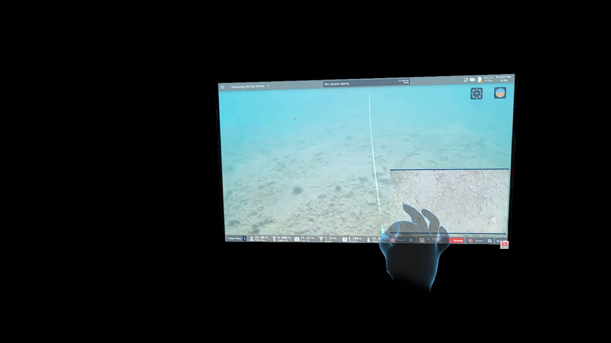

## El problema

La inspección del suelo marino y el mantenimiento de parques eólicos marinos se hacen con ROVs. El operario pilota el vehículo con un mando físico. Al mismo tiempo, vigila el vídeo, los datos de telemetría y el estado del vehículo en **Cockpit**, un software de control que se ejecuta en un ordenador junto al puesto de mando.

Este planteamiento tiene dos problemas:

1. **La atención está repartida.** El operario mira continuamente entre el mando y una pantalla separada. Los puestos de mando suelen estar al aire libre y cerca del puerto, donde el brillo del sol o el tiempo dificultan ver la pantalla.
2. **Las manos están ocupadas.** Para cambiar la visualización hay que usar teclado y ratón, y eso obliga a soltar el mando del ROV.

## La solución

- **Pantalla virtual en XR.** El escritorio del PC donde se ejecuta Cockpit se captura en la GPU y se muestra en un panel dentro del visor. El panel se puede coger, mover, redimensionar y centrar.
- **Cambio entre VR y realidad mixta.** El operario alterna entre un entorno inmersivo y el passthrough, para no perder de vista el entorno real.
- **Comandos de voz para tareas secundarias.** El mando sigue siendo la forma principal de pilotar el ROV. La voz se encarga del resto:
  - El operario dice la wake word ***"Hey Rovo"*** o muestra la palma de la mano abierta.
  - La aplicación responde *"¿Sí?"* y el operario dice el comando.
  - Todo se transcribe y se clasifica **en local**, sin servicios en la nube.

### Aportación

Los trabajos revisados hacen una de estas dos cosas:

- reconstruyen la interfaz del robot desde cero en VR, como TWINBOT
- sustituyen el mando físico por la voz, como la teleoperación de robots en AR guiada por LLM

Este proyecto **mantiene el mando**, **reutiliza el software de control existente** duplicando su pantalla y **añade interacción por voz local**. Esta combinación no aparece resuelta ni en la literatura ni en los productos comerciales revisados.

## Arquitectura

El sistema se divide en cuatro bloques:

- la aplicación de Unity XR
- el plugin nativo de captura de pantalla (StreamPantalla)
- el backend de voz en Python (VoiceService)
- la capa de comunicación TCP que une la voz con Unity

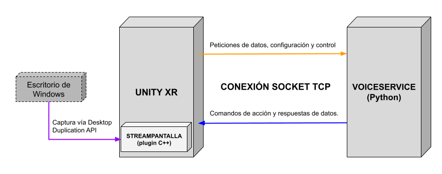

| Módulo | Tecnologías | Responsabilidad |
|---|---|---|
| **Aplicación Unity XR** (`TFM_EonSea/`) | Unity 6000.3.8f1, C#, URP, OpenXR + Unity OpenXR: Meta, XR Interaction Toolkit, XR Hands, AR Foundation, uGUI | Renderiza la escena, cambia entre paneles (inicio, configuración, duplicación de pantalla y lista de comandos), gestiona el passthrough, el hand tracking y el gesto de activación, abre el servidor TCP y ejecuta los comandos |
| **StreamPantalla** (`StreamPantalla/`) | C++, Direct3D 11, DXGI Desktop Duplication API, Unity Native Plugin API | Captura el escritorio de Windows en cada fotograma y lo copia **de GPU a GPU** en la textura de Unity, sin pasar por la CPU |
| **VoiceService** (`VoiceService/`) | Python 3.13, openWakeWord (ONNX), Faster-Whisper, RapidFuzz, sounddevice, psutil | Detecta la wake word, graba el comando, lo transcribe, lo clasifica y lo envía a Unity |

Todo se ejecuta **en local en un PC con Windows**. La comunicación entre Unity y VoiceService se queda en localhost. La única conexión que sale del PC es la del visor, mediante Meta Quest Link o Air Link.

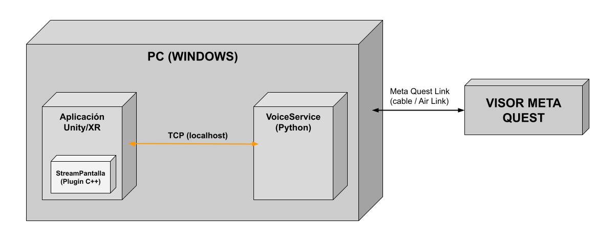

### Decisiones de diseño

- **Dos procesos independientes (Unity y Python).** openWakeWord y Faster-Whisper ofrecen sobre todo interfaces en Python. Además, separar los procesos protege la fluidez de la escena: si la gestión de voz falla, no afecta al hilo principal de Unity ni al framerate. El coste es tener que diseñar una capa de comunicación.
- **Desktop Duplication API.** La alternativa GDI/BitBlt trabaja en CPU. Windows.Graphics.Capture tiene limitaciones de personalización y muestra indicadores visuales. Desktop Duplication entrega los fotogramas directamente en memoria de GPU, lo que permite copiarlos de GPU a GPU en el device D3D11 de Unity.
- **Plugin nativo en C++.** Desktop Duplication es una API nativa basada en DXGI y Direct3D 11, sin un equivalente de alto nivel en C#. En C++ se accede directamente al device y al contexto D3D11 de Unity; por eso el Graphics API del proyecto está fijado a Direct3D 11. El plugin se recupera solo ante `DXGI_ERROR_ACCESS_LOST`, por ejemplo tras un cambio de resolución o un reinicio del driver.
- **Arquitectura de voz en dos capas.** Un modelo ligero de wake word escucha de forma continua. El modelo de transcripción, mucho más pesado, solo se activa tras una detección. Así se reduce el coste computacional.
- **Sockets TCP con mensajes JSON.** TCP está soportado de forma nativa en C# y en Python y garantiza que los mensajes no se pierdan ni lleguen desordenados. También permite, en el futuro, ejecutar VoiceService en otra máquina cambiando solo `config.json`. Unity actúa como servidor y Python como cliente, que reintenta la conexión cada segundo durante 30 s.
- **Comparación textual (fuzzy matching) en lugar de comprensión del lenguaje natural (NLU).** Con una lista cerrada de comandos, RapidFuzz es rápido, predecible, funciona sin conexión y tolera pequeños errores de transcripción.

## Flujo de un comando

El ejemplo es el comando *"Aumenta el tamaño"*:

1. VoiceService lee el micrófono en **bloques de 80 ms** y los pasa a openWakeWord, con un umbral de confianza de 0,5.
2. Al detectar "Hey Rovo", pide a Unity que reproduzca *"¿Sí?"*.
3. Graba **3 s** de audio y lo transcribe con Faster-Whisper (modelo `base`, en CPU, `int8`).
4. RapidFuzz busca la frase más parecida de la lista de comandos.
5. Se envía a Unity un mensaje JSON y `CommandManager` actualiza la escena.

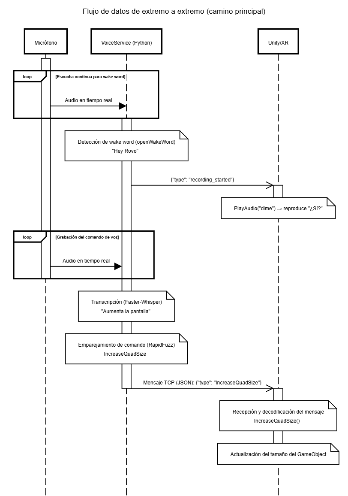

También se puede activar con un **hand pose**: palma abierta mirando hacia la cabeza, mantenida 0,2 s. Este gesto lanza el mismo pipeline desde Unity sin pasar por la wake word.

<b>Flujo con wake word descartada por falso positivo</b>

openWakeWord no es preciso al 100 %. Por eso, tras una detección se mide la energía (RMS) del fragmento de audio. Si es menor que 30, se descarta como ruido de fondo y se sigue escuchando. Este valor se ajustó de forma empírica.

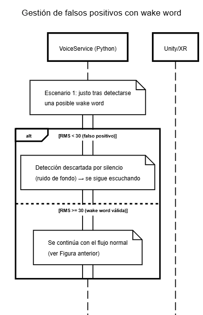

<b>Flujo con comando no reconocido</b>

El sistema intenta reconocer el comando como máximo **dos veces** por activación:

- Si falla el primer intento, Unity reproduce *"no te he entendido"* y se vuelve a grabar.
- Si falla el segundo, reproduce *"no encontrado"* y se vuelve a escuchar la wake word.

Este límite evita que el sistema se quede en un bucle de reintentos.

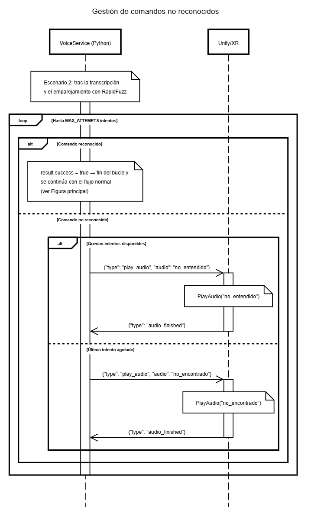

## Comandos de voz

Hay 15 comandos con unas 430 variantes de frase en total, definidas en `VoiceService/commands.json`. La aplicación incluye un panel con la lista de comandos disponibles.

| Categoría | Frases de ejemplo |
|---|---|
| Tamaño y distancia | "aumenta el tamaño", "reduce el tamaño", "acerca la pantalla", "aleja la pantalla" |
| Posición | "centra la pantalla", "sube la pantalla", "baja la pantalla", "mueve la pantalla a la derecha / izquierda" |
| Vista exterior (passthrough) | "muéstrame el exterior", "oculta el exterior" |
| Paneles | "abre / cierra la configuración", "abre / cierra los comandos" |

## Evaluación y resultados

Instrumenté los dos procesos para que escribieran logs CSV con estos datos:

- procesamiento de la wake word
- procesamiento de cada comando
- tiempo total del pipeline
- latencia entre procesos
- consumo de CPU y memoria
- FPS

Después ejecuté **4 sesiones repetidas con 118 intentos de procesamiento de comandos**, combinando la activación por wake word y por hand pose.

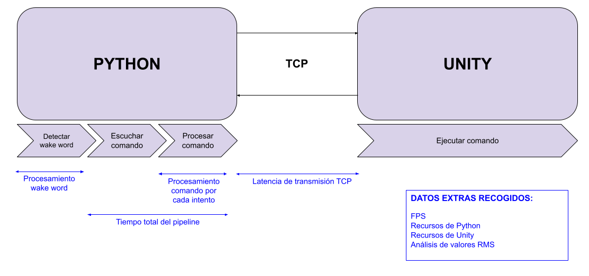

| Métrica | Resultado |
|---|---|
| Precisión cuando se encuentra un comando | **91,89 %** (102 aciertos, 9 errores, 7 no interpretados) |
| Acierto del clasificador cuando la transcripción es exacta | **100 %** |
| Acierto del clasificador con errores de transcripción | **80,43 %** |
| Tiempo de transcripción y clasificación | **401,58 ms** |
| Tiempo total del pipeline, de la activación al envío del comando | 5565,84 ms (incluye los 3 s fijos de escucha) |
| Latencia media entre Python y Unity | **5,71 ms** |
| VoiceService: CPU y memoria media | 0,81 % / 370 MB |
| Unity: CPU y memoria media | 1,50 % / 173 MB |
| Framerate medio | **71,96 FPS** |

### Tiempo del pipeline

El modo de activación no influye en el tiempo, como se esperaba. La primera sesión tras encender el ordenador fue casi un 50 % más lenta que las demás. Probablemente se debe a la carga inicial de modelos y cachés.

| Por modo de activación | Por sesión |
|---|---|
| 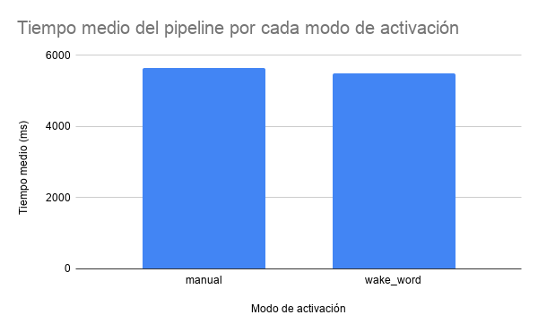 | 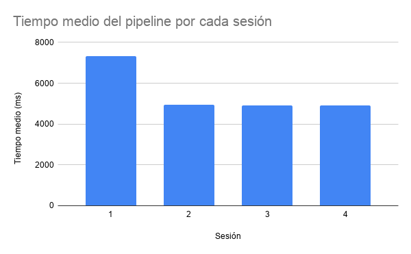 |

El **92,8 %** del tiempo se dedica a escuchar el comando y solo el 7,2 % a procesarlo. La mayor mejora posible está en sustituir la ventana fija de 3 s por una detección de fin de voz.

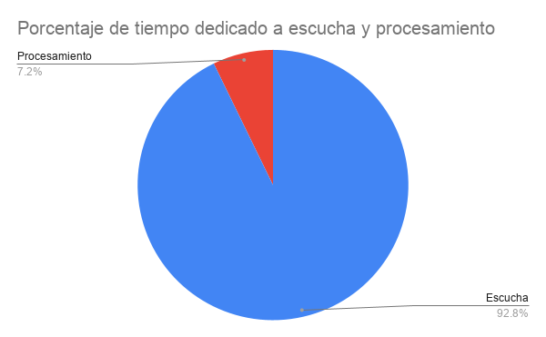

### Precisión

La mayoría de los fallos vienen de la transcripción, no del clasificador. Cuando Faster-Whisper transcribe la frase exactamente, el clasificador acierta el 100 % de las veces. Con errores de transcripción, sigue acertando el 80,43 %.

### Latencia entre procesos

La latencia media es de 5,71 ms, muy pequeña frente al resto del pipeline. Los mensajes que llevan más datos tardan más, como la lista de micrófonos o el JSON de configuración.

| Por tipo de mensaje | Por sesión |
|---|---|
| 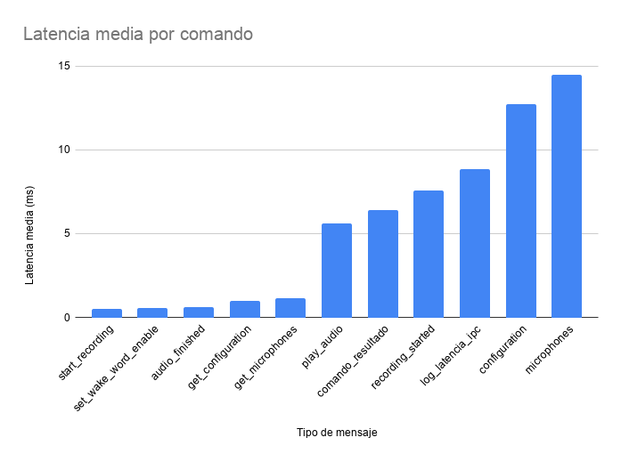 | 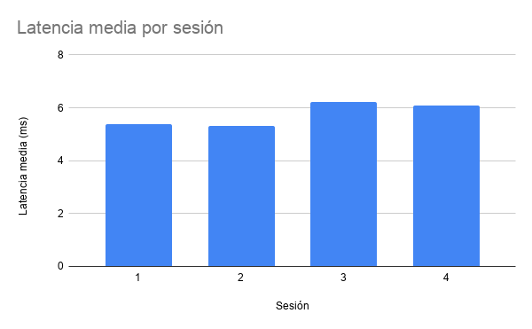 |

### Consumo de recursos

**VoiceService (Python).** El uso de CPU es prácticamente 0 en reposo, con picos del 6–10 % que coinciden con cada comando. La memoria se estabiliza en unos 370 MB tras cargar los modelos y no crece con el tiempo.

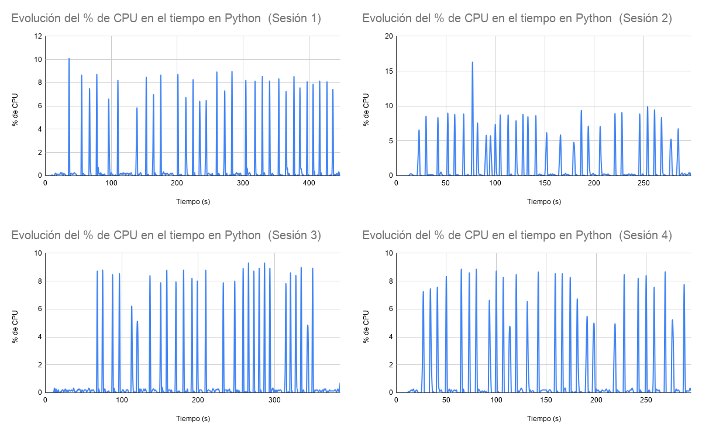
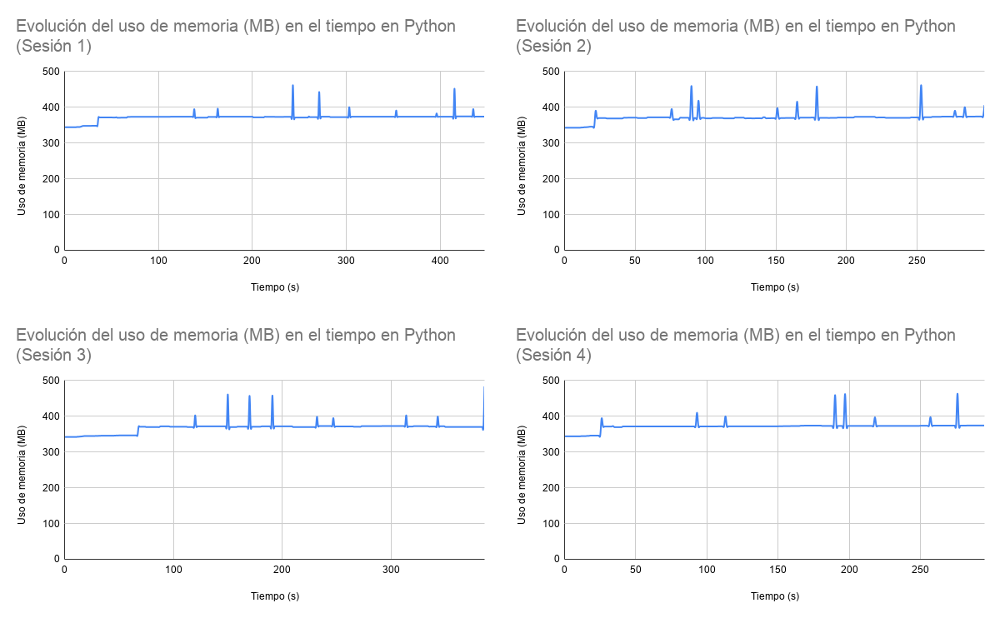

**Unity.** La CPU oscila de forma constante entre el 0,5 % y el 3 %, sin relación con la activación de comandos. La memoria se mantiene estable en unos 173 MB.

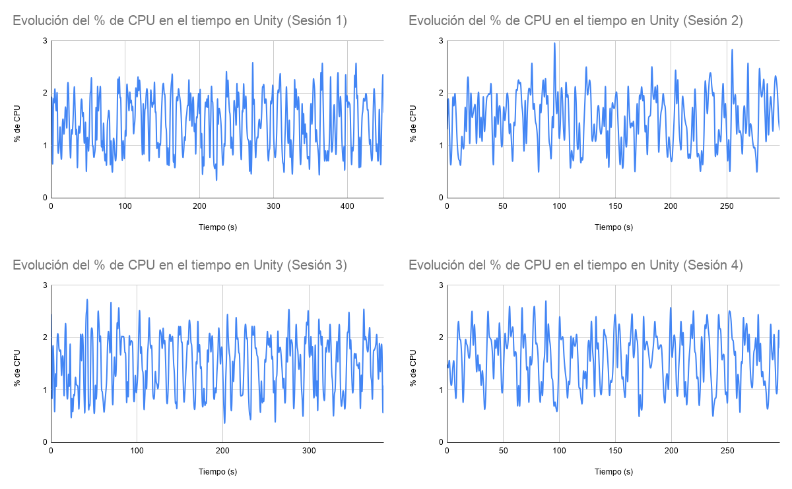
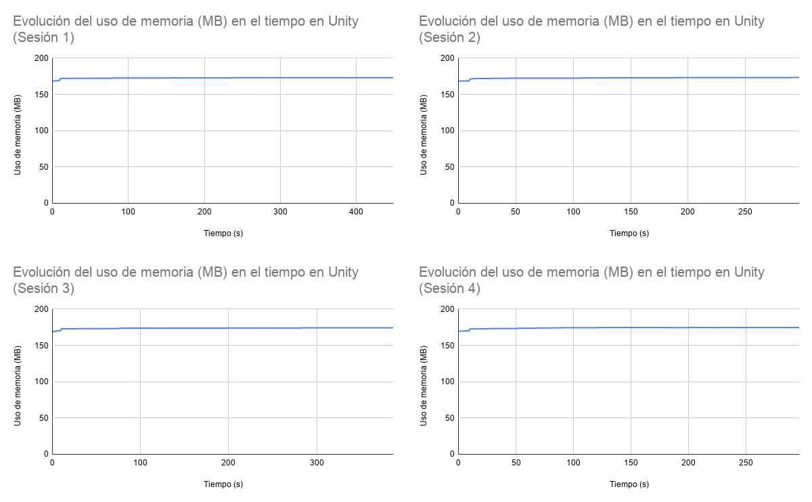

### FPS

El framerate arranca en 61–65 FPS, se estabiliza en 72 FPS y se mantiene así durante toda la sesión. Solo hay caídas puntuales hasta 69 FPS, que se recuperan al instante. La media es prácticamente idéntica en las cuatro sesiones.

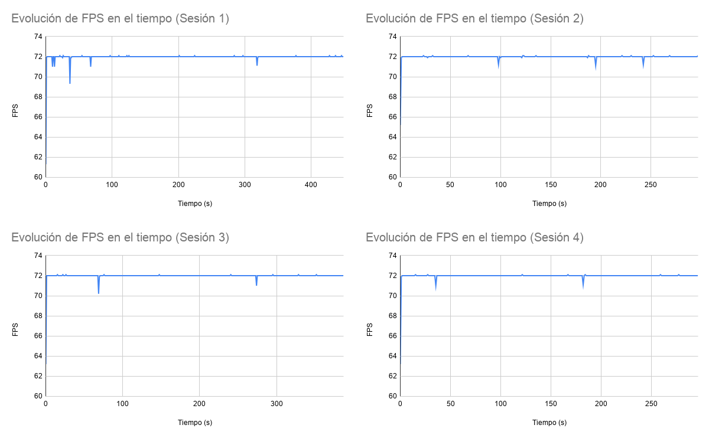

### Limitaciones de las pruebas

- Todas las pruebas las hizo la autora: una sola voz y un solo acento, en un único PC y visor. Por eso los resultados no se pueden generalizar ni se pudo analizar la experiencia de usuario.
- Los dos procesos se ejecutaron en la misma máquina, así que la latencia medida no incluye la de una red.

## Limitaciones conocidas

- **No hay integración directa con Cockpit.** Se duplica su pantalla, así que la voz controla la pantalla virtual, no valores concretos de la telemetría.
- **El passthrough no se puede activar en la versión compilada.** Faltan desarrollos por parte de Meta OpenXR para PC.
- **Solo funciona en Windows**, porque depende de Desktop Duplication API y Meta Quest Link.
- Está pensado para **un único operario**, con **comandos en español** y un entorno con ruido moderado.

## Trabajo futuro

- Grabar el comando con duración dinámica, parando cuando el usuario deja de hablar.
- Probar otros modelos de reconocimiento de voz.
- Calibrar el volumen de voz del usuario y adaptar el sistema a distintos acentos y entonaciones.
- Integrar Cockpit directamente para mostrar u ocultar datos concretos por voz.
- Mostrar en tiempo real máscaras de anomalías generadas con modelos de visión artificial.
- Medir la latencia con los procesos en máquinas distintas.
- Añadir una fase de introducción con instrucciones de uso.

## Lo que he aprendido

- Interoperabilidad GPU sin copias intermedias entre un plugin nativo D3D11 y el hilo de render de Unity.
- Diseño de un pipeline de voz local y offline, equilibrando latencia y precisión: wake word frente a activación manual, tamaño del modelo Whisper, fuzzy matching frente a NLU.
- Diseño de comunicación entre procesos: TCP frente a UDP, E/S bloqueante en hilos secundarios y sincronización del arranque.
- Instrumentación de un sistema en tiempo real y evaluación mediante sesiones experimentales repetidas.

## Tecnologías

- **Unity 6** (6000.3.8f1) con Universal Render Pipeline y **C#**
- **OpenXR** + Unity OpenXR: Meta, **XR Interaction Toolkit**, **XR Hands** y **AR Foundation**
- **C++**, **Direct3D 11** y **DXGI Desktop Duplication API** para el plugin nativo
- **Python 3.13** con **openWakeWord** (ONNX), **Faster-Whisper** y **RapidFuzz**
- **Sockets TCP** con mensajes **JSON** para la comunicación entre procesos
- **Meta Quest** con Meta Quest Link o Air Link

## Contenido del repositorio

- [`TFM_EonSea/`](TFM_EonSea): proyecto de Unity XR (`Assets`, `Packages`, `ProjectSettings`). El plugin compilado está en `Assets/Plugins/x86_64/StreamPantalla.dll`.
- [`StreamPantalla/`](StreamPantalla): código fuente del plugin nativo en C++ (proyecto DLL de Visual Studio 2022).
- [`VoiceService/`](VoiceService): backend de voz en Python. Incluye el modelo de wake word (`models/hey_rovo.onnx`), la lista de comandos (`commands.json`) y la configuración (`config.json`).
- [`docs/`](docs): memoria del TFM e imágenes.

El modelo `hey_rovo.onnx` se entrenó en Google Colab con un notebook de la comunidad que corrige el de openWakeWord ([alfiedennen/openwakeword-colab-2026](https://github.com/alfiedennen/openwakeword-colab-2026)). Genera muestras sintéticas de "Hey Rovo" con Piper TTS y las aumenta con ruido y respuestas al impulso de salas.

## Licencias

La memoria del TFM es © Olaia Picabea Sainz. Las cabeceras de `StreamPantalla/UnityPluginAPI/` son © Unity Technologies. Los assets de plantillas y samples de Unity (`Assets/Samples`, `Assets/VRTemplateAssets`, `Assets/TextMesh Pro`) tienen sus propias licencias.
